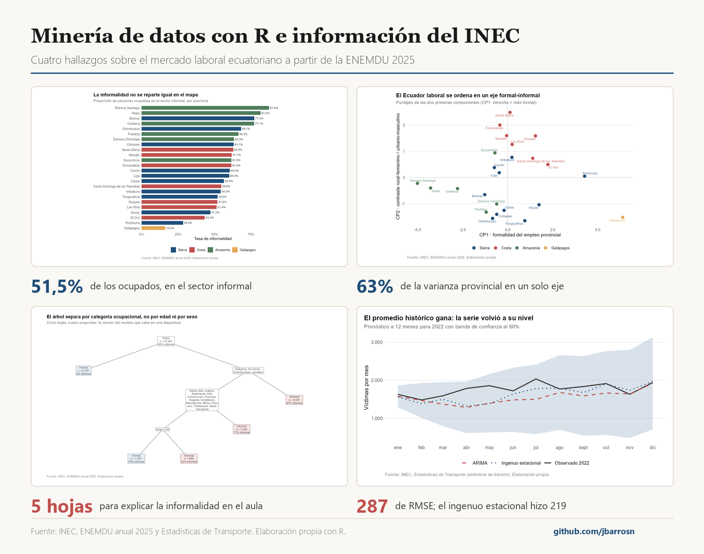
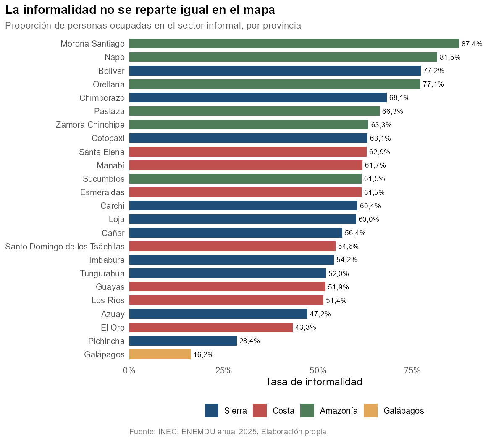
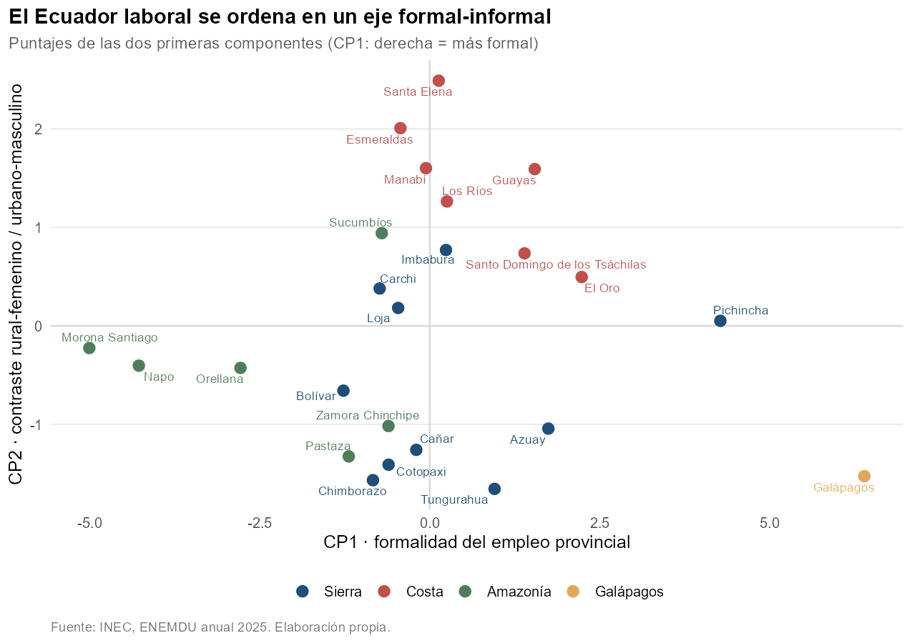
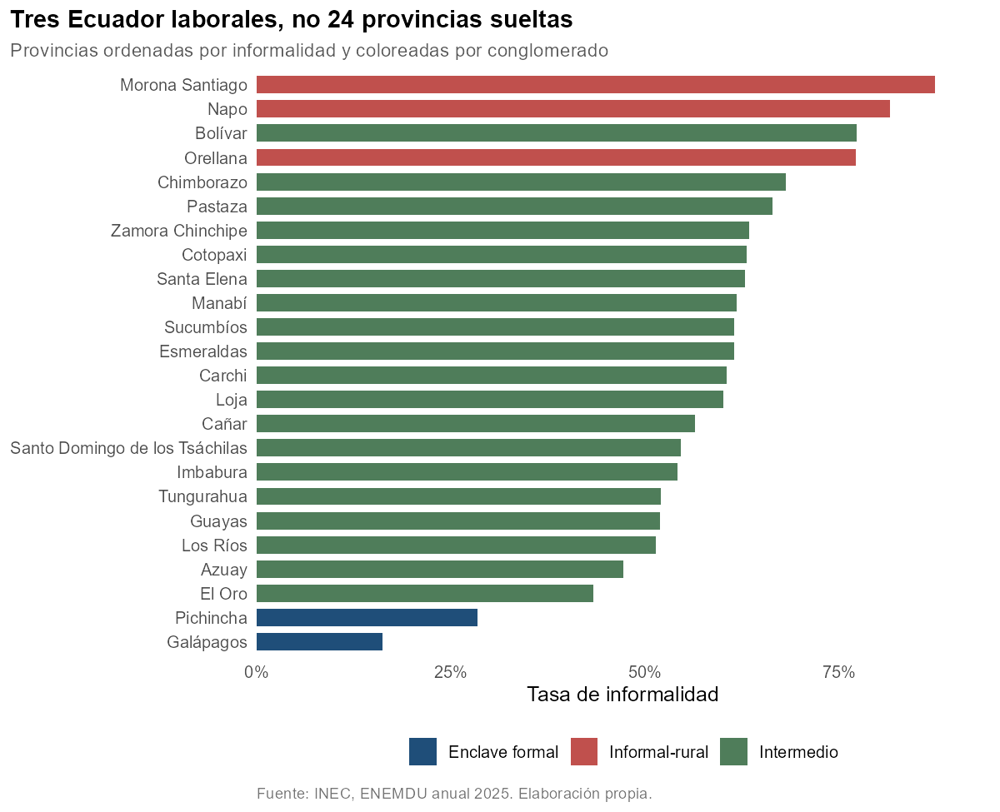
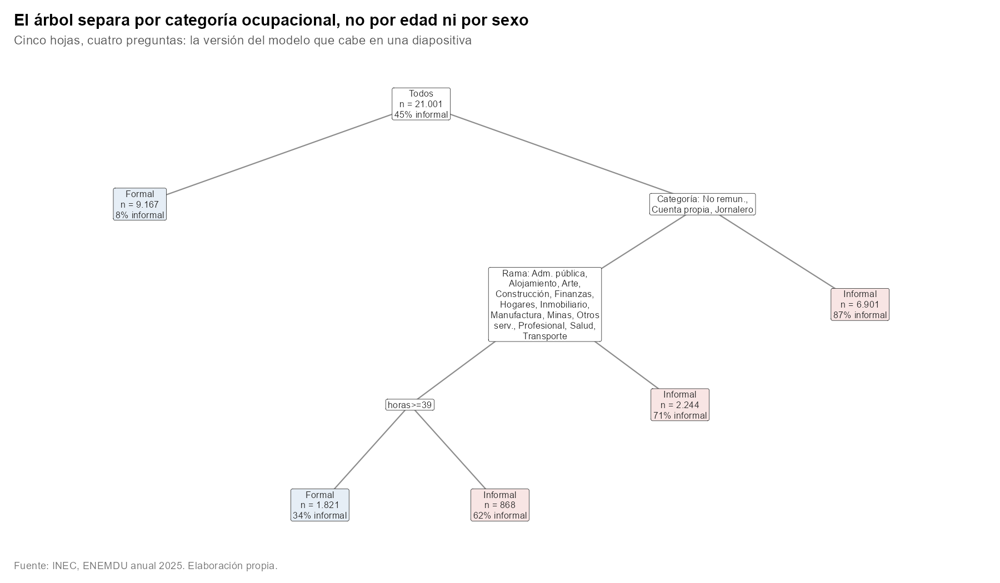
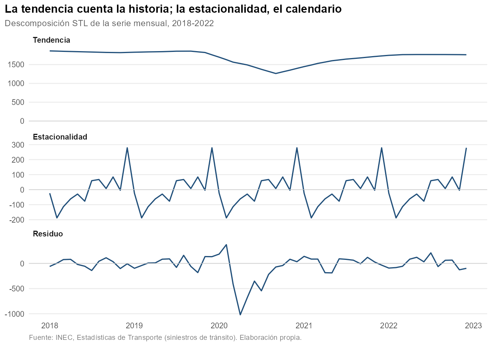
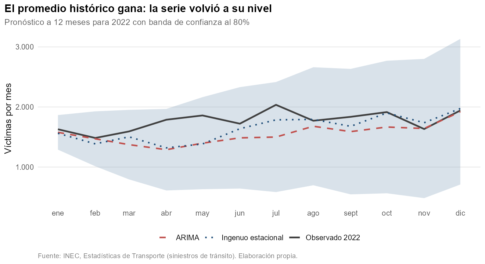

# Minería de datos con R e información del INEC

**Un proyecto, cuatro sesiones y ocho scripts que corren de punta a punta** para enseñar
minería de datos con microdatos oficiales del Ecuador. Sin ejemplos inventados: la ENEMDU
2025 y los registros de siniestros de tránsito del INEC.

La pregunta que sostiene todo el trabajo:

> ¿Dónde y en quién se concentra la vulnerabilidad laboral del Ecuador, y qué parte de ella
> se puede anticipar?



---

## Los cuatro hallazgos

| Bloque | Hallazgo | Cifra | Script |
|---|---|---|---|
| 3.1 Preprocesamiento | La informalidad no es un dato, es una decisión: 51,5% de los ocupados está en el sector informal, con 35 puntos de brecha entre provincias | 51,5% | `01_crisp_dm.R` |
| 3.2 Análisis multivariante | Nueve indicadores provinciales son casi una sola cosa: una componente explica el 62,6% de la estructura | 62,6% | `02_pca.R` · `03_cluster.R` |
| 3.3 Aprendizaje automático | El modelo más preciso no es el más explicable: la logística gana en AUC (0,933), el árbol de cinco hojas pierde 0,049 y se elige igual | 0,933 | `04_arboles_knn.R` · `05_validacion.R` |
| 3.4 Series de tiempo | El pronóstico sofisticado pierde: RMSE de 287 para el ARIMA frente a 219 del ingenuo estacional | 287 vs 219 | `06_series.R` · `07_arima.R` |

Los tres últimos resultados son incómodos y se enseñan así, sin maquillaje. Un curso de
minería de datos que solo muestra modelos ganadores enseña a presumir, no a evaluar.

---

## Cómo se ejecuta

Requiere **R 4.6** con `haven`, `dplyr`, `ggplot2`, `FactoMineR`, `factoextra`, `cluster`,
`caret`, `rpart`, `pROC`, `forecast`, `tseries` y `officer`.

Los microdatos del INEC **no se distribuyen con el repositorio** (170 MB en archivos SPSS).
Se descargan de [ecuadorencifras.gob.ec](https://www.ecuadorencifras.gob.ec/) y se apunta
la variable de entorno `INEC_DIR` a la carpeta que los contiene:

```powershell
$env:INEC_DIR = "D:/DatosINEC"
```

```bash
export INEC_DIR="$HOME/DatosINEC"
```

Después, desde la raíz del proyecto:

```powershell
1..8 | ForEach-Object {
  $f = (Get-ChildItem scripts -Filter ("0" + $_ + "_*.R")).FullName
  & Rscript $f
}
```

Cada script lee lo que dejó el anterior. La semilla `20261112` está fijada una sola vez, en
`00_setup.R`: sin ella la partición de entrenamiento y prueba cambia y las métricas de la
sesión 3 no se repiten.

---

## Estructura

```
.
├── scripts/
│   ├── 00_setup.R           rutas, paquetes, semilla y tema gráfico
│   ├── 01_crisp_dm.R        3.1  base analítica y preprocesamiento
│   ├── 02_pca.R             3.2.1 componentes principales
│   ├── 03_cluster.R         3.2.2 k-medias y jerárquico
│   ├── 04_arboles_knn.R     3.3.1 árboles y k-vecinos
│   ├── 05_validacion.R      3.3.2 validación cruzada y métricas
│   ├── 06_series.R          3.4.1 descomposición y suavizado
│   ├── 07_arima.R           3.4.2 ARIMA y pronóstico
│   └── 08_documento.R       genera el plan de clase en Word
├── datos/                   microdatos (no incluidos) y su instructivo
├── salidas/
│   ├── figuras/             22 figuras a 150 ppp
│   └── tablas/              17 tablas de resultados en CSV
└── docs/
    ├── portada_resultados.png
    ├── Plan_team_teaching_mineria_datos_final.docx
    ├── clase.html           deck de la unidad completa
    ├── diapositivas/        siete juegos, uno por script (plantilla UTM)
    └── Flyer_Conferencia_Team_Teaching.png
```

---

## Resultados

**La informalidad provincial.** Morona Santiago 87,4%, Galápagos 16,2%. La brecha es
estructura, no ruido.



**El país en dos ejes.** La primera componente ordena las provincias de lo formal a lo
informal; la segunda contrasta ruralidad y participación femenina.



**Tres regímenes, no veinticuatro provincias sueltas.** 19 intermedias, 3 informal-rurales
y 2 de enclave formal. k-medias y Ward coinciden en el 100% de las asignaciones.



**El árbol que se explica solo.** Cinco hojas: la primera pregunta es la categoría
ocupacional, la segunda la rama de actividad. Ni la edad ni el sexo aparecen.



**La descomposición que separa el calendario de la historia.** Fuerza estacional 0,24;
de tendencia 0,53. Diciembre es el pico, febrero el valle.



**El pronóstico que pierde.** El ARIMA arrastra el nivel deprimido de 2021 y pronostica por
debajo; la banda al 80% no cubre 2022. Ljung-Box da p = 0,033: el modelo está mal
especificado, y se reporta.



---

## Cinco decisiones que el repositorio deja por escrito

1. **Qué cuenta como informal.** Se usa el sector informal (`secemp = 2`), no la definición
   amplia que suma servicio doméstico y no clasificados. La tasa cambia; la declaración
   también.
2. **Ponderar siempre con `fexp`.** Sin el factor de expansión el indicador describe la
   muestra, no el país.
3. **`-1` y `999999` no son ingresos.** Son códigos de no respuesta y se tratan como
   perdidos antes de cualquier media.
4. **Nada de fuga de información.** El tamaño del establecimiento y el RUC construyen la
   definición de informalidad: si entran como predictores, el modelo repite la respuesta.
5. **El umbral se elige en entrenamiento.** Elegirlo mirando el conjunto de prueba es una
   forma elegante de hacer trampa.

---

## Material docente

- **Plan de clase** — `docs/Plan_team_teaching_mineria_datos_final.docx`: cuatro sesiones de
  100 minutos, con la secuencia, los errores frecuentes y la rúbrica.
- **Diapositivas** — `docs/diapositivas/`: siete juegos, uno por script, con la plantilla
  institucional de la ESPOCH.
- **Deck HTML** — `docs/clase.html`: la unidad completa en una sola página.
- **Flyer** — `docs/Flyer_Conferencia_Team_Teaching.png`.

---

## Datos y atribución

Los datos son públicos y propiedad del **Instituto Nacional de Estadística y Censos (INEC)**.
Este repositorio no los redistribuye: publica el código que los procesa y los resultados
derivados. La ENEMDU anual 2025 corresponde al operativo publicado por el INEC; las cifras
de siniestros provienen de las Estadísticas de Transporte.

## Autor

**Jhon Barros** · [github.com/jbarrosn](https://github.com/jbarrosn)

## Licencia

Código y textos bajo licencia MIT (ver `LICENSE`). Las figuras y tablas derivadas pueden
usarse citando la fuente.
